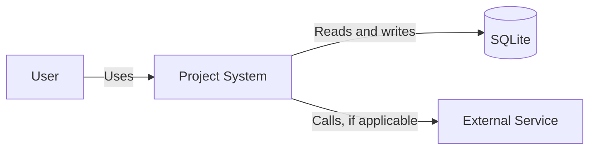
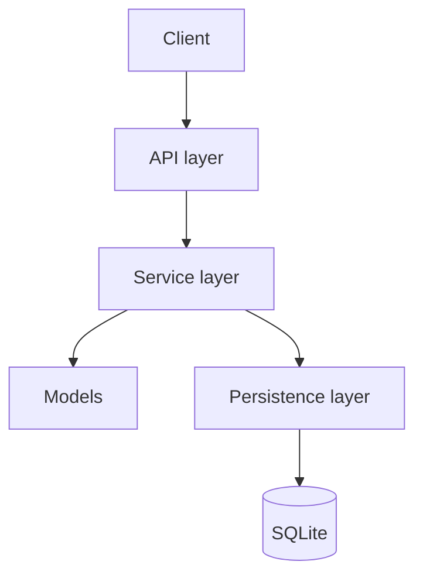
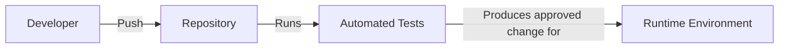

# Software Architecture Document

> Replace the bracketed text and examples with project-specific content. Focus
> on the decisions that shape the system and the reasoning behind them. Keep
> this document current as the implementation changes.

## Document Information

| Field | Value |
| --- | --- |
| Project | [Project name] |
| Authors | [Names] |
| Version | [For example, 1.0] |
| Last updated | [YYYY-MM-DD] |
| Status | [Draft / In review / Approved] |

## 1. Architecture Overview

### 1.1 Summary

[Describe the architecture in one short paragraph: its overall style, major
parts, and how they collaborate to serve the product goal.]

### 1.2 Architecture Goals

- [Quality or business goal that materially influences the design]
- [Another design goal, ideally linked to an SRS requirement]

### 1.3 Constraints and Assumptions

- **Constraint:** The starter uses FastAPI for HTTP handling and SQLite for
  local persistence unless the project team documents a justified change.
- **Constraint:** [Deployment, technology, policy, schedule, or team limit]
- **Assumption:** [Condition on which the design depends]

## 2. System Context

[Explain the system boundary, users, and external systems. The following
Mermaid diagram is optional; edit it or replace it with a linked image.]

| Actor or external system | Relationship to this system |
| --- | --- |
| [User role] | [What the actor sends, receives, or accomplishes] |
| [External service] | [Data exchanged and why] |

## 3. Solution Structure

The starter separates external interfaces, business logic, domain or data
representations, and persistence. Extend this structure when it improves
cohesion; document any deliberate deviation.

| Component | Responsibility | Collaborators | Related requirements |
| --- | --- | --- | --- |
| `app/api` | HTTP routes, request validation, and response formatting | `app/services` | [FR IDs] |
| `app/services` | Application workflows and business rules | `app/models`, `app/database` | [FR IDs] |
| `app/models` | Domain and data representations | Services and persistence | [FR/NFR IDs] |
| `app/database` | Connections, queries, and transaction boundaries | SQLite, services | [FR/NFR IDs] |
| [Additional component] | [One clear responsibility] | [Dependencies] | [Requirement IDs] |

### 3.1 Component Diagram

[Edit this diagram so it reflects the implemented dependency direction.]

### 3.2 Dependency Rules

- [For example: API handlers delegate business decisions to services.]
- [For example: database details do not leak into API response models.]
- [State how circular dependencies and shared utilities are handled.]

## 4. Data Architecture

### 4.1 Data Model

[Describe the main entities, relationships, ownership, and lifecycle. Include
an entity-relationship diagram when it makes those relationships clearer.]

| Entity or table | Purpose | Key relationships | Integrity rules |
| --- | --- | --- | --- |
| [Entity] | [What it stores] | [References or ownership] | [Keys, uniqueness, checks, or deletion behavior] |

### 4.2 Persistence Decisions

[Explain schema creation or migrations, transaction boundaries, connection
management, and how test data is isolated. The starter connection helper
enables SQLite foreign-key enforcement but does not prescribe a schema.]

## 5. Runtime Behavior

Document one or two important request flows, especially where errors,
transactions, external calls, or security boundaries are involved.

### 5.1 [Name of Key Workflow]

1. [The client sends a request.]
2. [The API validates input and delegates work.]
3. [The service applies business rules.]
4. [Persistence completes or rolls back the operation.]
5. [The API returns the documented result.]

**Failure behavior:** [Describe validation errors, unavailable dependencies,
rollback behavior, and what the user sees.]

## 6. Interfaces and Contracts

| Interface | Contract | Validation | Failure behavior |
| --- | --- | --- | --- |
| [HTTP endpoint or external API] | [Method, path, and request/response shape] | [Input rules] | [Status codes, retries, or fallback] |

[Reference detailed API documentation rather than duplicating it when one
source of truth already exists.]

## 7. Cross-Cutting Concerns

### 7.1 Security and Privacy

[Describe authentication, authorization, input validation, secret management,
sensitive-data handling, and relevant threats. Do not record secrets here.]

### 7.2 Reliability and Error Handling

[Describe expected failures, exception boundaries, recovery, consistency, and
user-visible error behavior.]

### 7.3 Performance and Scalability

[Identify expected workload, likely bottlenecks, measurement plans, and how the
design meets performance requirements. Avoid unsupported scale claims.]

### 7.4 Accessibility

[Explain architectural support for the accessibility requirements in the SRS,
including semantic output and preservation of assistive-technology metadata.]

### 7.5 Observability

[Describe useful logs, metrics, or diagnostics; state how private data and
credentials are excluded from telemetry.]

### 7.6 Test Strategy

[Explain the unit, integration, and end-to-end boundaries and how external
dependencies and the database are controlled in tests.]

## 8. Deployment and Operations

[Describe environments, configuration, startup, CI checks, database setup or
migrations, backups if relevant, and the release process.]

## 9. Architecture Decisions

Record consequential choices and their tradeoffs. For a complex decision,
create a separate architecture decision record and link it here.

| ID | Decision | Alternatives considered | Rationale and tradeoffs | Status |
| --- | --- | --- | --- | --- |
| ADR-001 | [Chosen approach] | [Other viable approaches] | [Why this best fits the requirements, plus its costs] | [Proposed / Accepted / Superseded] |

## 10. Risks and Technical Debt

| ID | Risk or debt | Impact | Mitigation or follow-up | Owner |
| --- | --- | --- | --- | --- |
| A-001 | [Known design risk or intentional shortcut] | [Affected requirement or quality] | [Action, trigger, or review date] | [Name or role] |

## 11. Requirements Traceability

| Requirement | Architecture response | Verification |
| --- | --- | --- |
| [FR-001 or NFR-001] | [Component, workflow, or decision that addresses it] | [Test, review, measurement, or planned evidence] |

## 12. Open Questions

- [Question that must be resolved before the design or implementation is stable]
